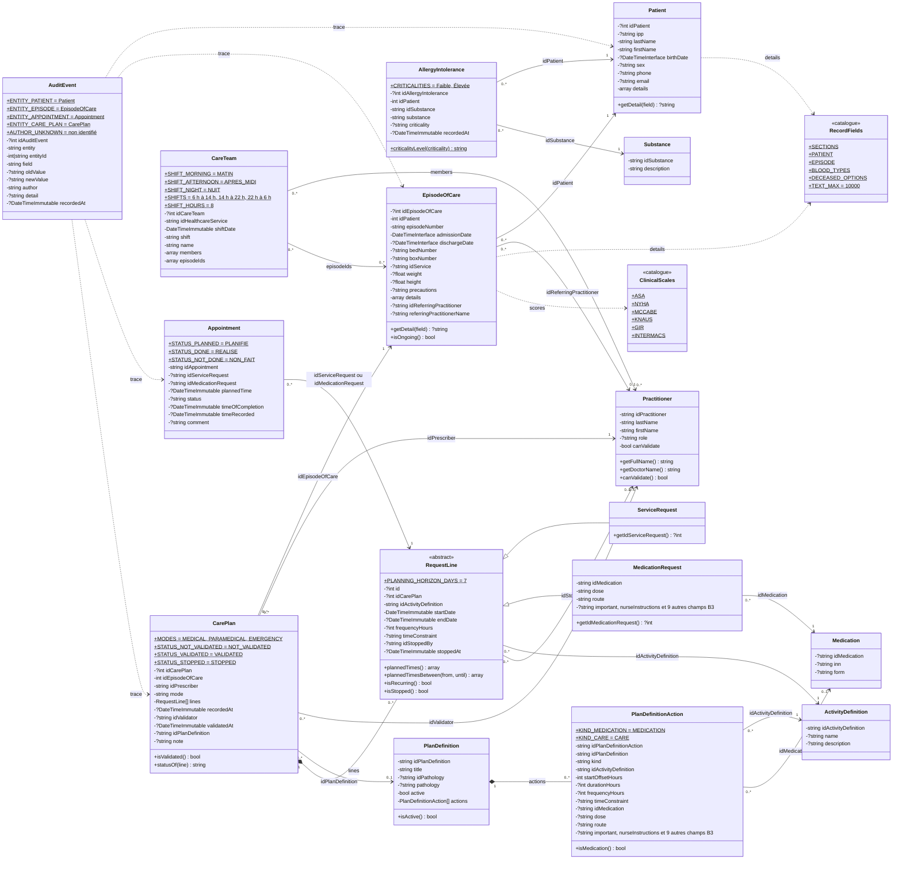
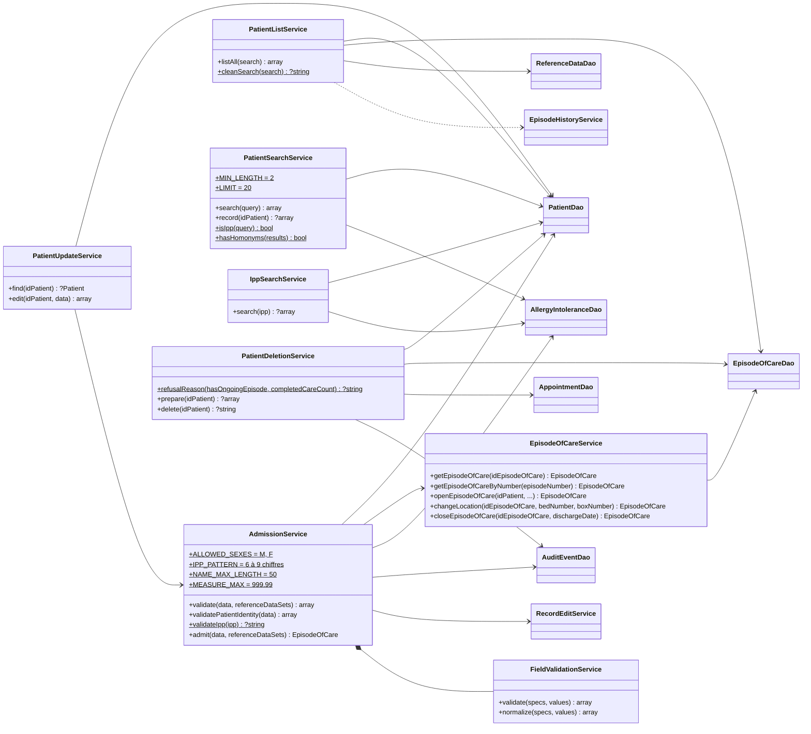
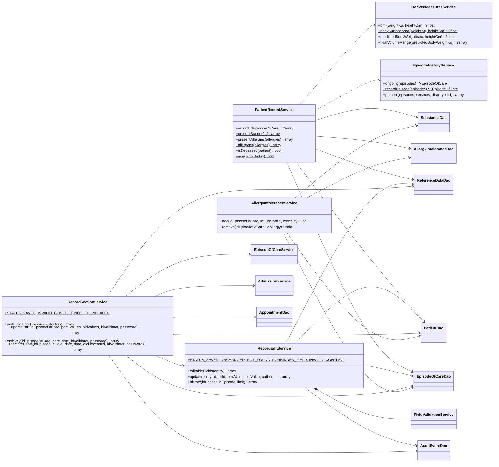
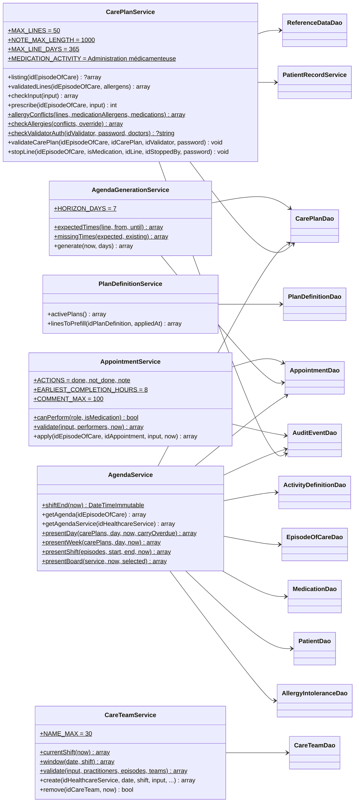
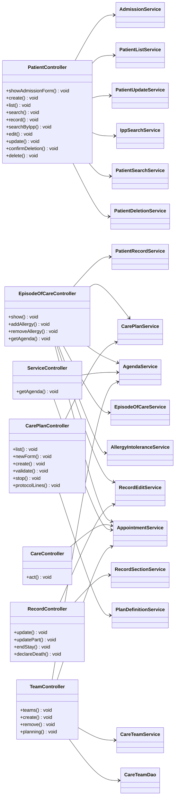

# Architecture d'AURA

Application PHP 8.4 sans framework, MariaDB 11.8, servie telle quelle (aucun build). Ce document décrit les
modules, le trajet d'une requête, le modèle de données réel et les décisions de conception retrouvées dans le dépôt.

## Modules

| Dossier | Rôle | Règle |
| --- | --- | --- |
| `public/index.php` | Point d'entrée : déclare les routes et construit chaque contrôleur avec ses dépendances (injection manuelle par closures). | La connexion PDO (`Database::get()`) n'est ouverte que dans la closure de la route qui en a besoin. |
| `src/Core` | `Router` (routes exactes GET / POST), `Database` (PDO unique, paresseux, config sans secret dans la trace), `View` (rendu des gabarits, `e()` pour échapper), `Csrf` (jeton de session des écritures), `DateInput` (dates JJ/MM/AAAA), `ConfigurationException`. | Aucune logique métier. |
| `src/Controller` | Lit `$_GET` / `$_POST` / le corps JSON, mappe les champs de formulaire vers les clés du domaine, appelle un service, répond en HTML (`View::page`) ou JSON. | Ne valide pas. Détecte l'AJAX par `Accept: application/json` ou `X-Requested-With`. |
| `src/Service` | Règles métier. `validate()` est pure (sans PDO ni HTTP, date injectée) ; les écritures passent par `Transaction::run()`. | Un service par cas d'usage ; les méthodes `present*()` préparent des vue-modèles testables sans base. |
| `src/Dao` | Seul endroit où apparaissent les colonnes SQL (camelCase anglais HL7). Requêtes préparées, ids `VARCHAR(20)` calculés par `MAX(CAST(id AS UNSIGNED)) + 1 … FOR UPDATE`. | Traduction colonnes ↔ entités ; listes blanches de colonnes pour les mises à jour partielles. |
| `src/Domain` | Entités immuables (getters), constantes métier (`ClinicalScales`, `RecordFields`, statuts). | Pas d'accès aux données. |
| `src/View` | `layouts/main.php`, `components/` (form, field, patient_banner, breadcrumb, status_badge, empty_state, icon, agenda_table, care_line, care_buttons, validation_dialog…), `pages/`. Chaque gabarit déclare ses variables en `@var` dans son en-tête. | Tout est échappé par `View::e()` ; pas de fonction nommée dans une vue. |
| `public/css/style.css`, `public/js/*.js`, `public/fonts/` | Un seul fichier CSS (blocs ajoutés en fin de fichier), scripts vanilla par fonctionnalité, police vendorisée. | Aucun CDN. |
| `database/` | `schema.sql` (structure complète, rejouée sur base vide par le CI), `test.sql` (données de démo fictives), `demo-today.sql` (recale la démo sur le jour courant), `migrations/` (mises à jour rejouables d'une base existante, dans l'ordre des noms). | Le schéma est géré par le responsable BDD. |
| `bin/generate-agenda.php` | Génération quotidienne de l'agenda (cron), voir le README. | Même configuration que le site. |

## Trajet d'une requête

1. `public/index.php` lit le chemin ; un fichier statique existant est servi directement (serveur PHP intégré).
2. Le `Router` trouve la closure de la route (méthode + chemin exact) ou rend la page 404.
3. La closure ouvre le PDO si nécessaire et construit le contrôleur avec ses services et DAO.
4. Le contrôleur mappe la requête vers les clés du domaine et appelle le service.
5. Le service valide (pur), puis écrit dans une transaction via les DAO.
6. Le contrôleur répond : page HTML (`View::page`, layout + bandeau + contenu), redirection 303 après un POST réussi
   (POST → redirect → GET), ou JSON (`{ok, errors}` en 422, `{ok, redirect}` ou données en 200).
7. `ConfigurationException` (config absente, base injoignable) est rattrapée dans `index.php` : message en texte brut, sans identifiant.

## Pages et endpoints

Liste complète des routes de `public/index.php`. Les identifiants passent en query string ou dans le corps du
POST (pas de paramètre dans le chemin). « CSRF » : jeton de session obligatoire (en-tête `X-CSRF-Token` ou champ
`csrf`), 403 sinon. « Auth. factice » : praticien choisi dans une liste et mot de passe non vérifié, en attendant
l'authentification des praticiens.

| Méthode et chemin | Rôle |
| --- | --- |
| `GET /` | Formulaire d'admission (recherche d'un patient existant, identité, motif, service, médecin référent, allergies, sections repliables). Affichable sans base. |
| `POST /patients/create` | Admission : validation, création ou rattachement du patient, ouverture du séjour, allergies, traces ; JSON ou HTML, CSRF. |
| `GET /patients?q=` | Liste des patients : séjour en cours, sinon dernier dossier, historique des séjours dépliable, décès signalé ; recherche facultative. |
| `GET /patients/modifier?id=`, `POST /patients/modifier?id=` | Modification de l'identité d'un patient (CSRF). |
| `GET /patients/supprimer?id=`, `POST /patients/supprimer?id=` | Confirmation puis suppression logique d'un patient (CSRF) ; 409 si refusée (séjour en cours ou soin réalisé). |
| `GET /patients/recherche-ipp?ipp=` | Identité d'un patient par IPP (JSON, conservé). |
| `GET /patients/recherche?q=` | Recherche par IPP ou mots du nom / prénom (JSON, identité seulement, 20 max). |
| `GET /patients/fiche?id=` | Fiche complète d'un patient pour pré-remplir l'admission (JSON, à la sélection d'un résultat). |
| `GET /sejour?id=` | Dossier du séjour : bandeau, allergies, dossier complet éditable, prescriptions validées, séjours du patient, historique. |
| `POST /sejour/allergies/ajouter`, `POST /sejour/allergies/retirer` | Allergies du patient depuis le dossier (CSRF). Le retrait est physique (dette connue). |
| `POST /sejour/champ/modifier` | Modification d'un champ du dossier (édition en ligne) : JSON, CSRF, auth. factice d'un médecin, concurrence optimiste, trace AuditEvent au nom du médecin. Le décès est refusé ici ; le groupe sanguin n'a pas de crayon dans le dossier (il passe par la partie). |
| `POST /sejour/partie/modifier` | Modification d'une partie entière du dossier (identité, séjour, sections), JSON, CSRF, auth. factice d'un médecin, tout ou rien, tracée. Seule voie pour modifier le groupe sanguin. |
| `POST /sejour/cloturer` | Fin du séjour (date et heure de sortie), JSON, CSRF, auth. factice d'un médecin, tracée. |
| `POST /sejour/deces` | Déclaration du décès (date et heure) : le patient est marqué décédé, le séjour en cours se termine à cette heure et ses soins encore prévus sont annulés. JSON, CSRF, auth. factice d'un médecin, tracée. |
| `GET /care-plans?idEpisodeOfCare=` | Prescriptions du séjour (statut de validation RG5, période, note, allergène signalé). |
| `GET /care-plans/new?idEpisodeOfCare=`, `POST /care-plans/create?idEpisodeOfCare=` | Nouvelle prescription (écran B3) ; l'enregistrement (CSRF, auth. factice du prescripteur) planifie aussi ses soins. |
| `POST /care-plans/validate?idEpisodeOfCare=` | Validation d'une ordonnance par un médecin habilité (RG5, CSRF, auth. factice). |
| `POST /care-plans/stop?idEpisodeOfCare=` | Arrêt d'une ligne par un médecin (CSRF, auth. factice) ; ses soins encore prévus sont annulés. |
| `GET /care-plans/protocol-lines?idPlanDefinition=&startDate=` | Lignes d'un protocole datées à partir d'une date de début, pour pré-remplir l'ordonnance (JSON). |
| `GET /agenda-patient?id=` ou `?numSejour=`, `&date=`, `&vue=semaine` | Agenda du séjour, jour (retards épinglés, rotations) ou semaine (lundi à dimanche). |
| `POST /agenda-patient/soin` | Action sur un soin : réalisé, non effectué (motif obligatoire) ou note. JSON ou formulaire, CSRF, auth. factice du soignant ; validation possible jusqu'à la fin de la rotation en cours, une seule fois. |
| `GET /agenda-service?idHealthcareService=&date=&vue=&sejour=` | Agenda du service : « Lits » (`vue=lits`, par défaut ; `sejour=` choisit le patient du panneau de détail) ou « Liste de travail » (`vue=liste`). |
| `GET /equipes?idHealthcareService=&date=&rotation=` | Équipes de la rotation (matin, après-midi ou nuit) et formulaire de composition. |
| `POST /equipes/creer`, `POST /equipes/retirer` | Composer une équipe ou la retirer (suppression logique), CSRF, retour à la rotation. |
| `GET /mon-planning?idPractitioner=&date=&rotation=` | Soins des patients des équipes d'un soignant pendant la rotation, avec les mêmes actions que l'agenda. |

Toute autre adresse : page 404 (`View::error()`).

## Modèle de données

Diagramme tiré de `database/schema.sql` (branche `main` du 2026-11-04) : 20 tables, 29 clés étrangères.

```mermaid
erDiagram
    Patient {
        VARCHAR(20) idPatient PK
        INT ipp UK
        VARCHAR(50) firstName
        VARCHAR(50) lastName
        VARCHAR(10) phoneNumber
        VARCHAR(50) email
        VARCHAR(1) sex
        DATE birthDate
        BOOLEAN deceased
        VARCHAR(100) generalPractitioner
        VARCHAR(100) address
        VARCHAR(3) bloodType
        VARCHAR(50) birthLastName
        VARCHAR(50) birthFirstName
        VARCHAR(20) insNumber
        VARCHAR(100) trustedPersonName
        VARCHAR(20) trustedPersonPhone
        VARCHAR(100) trustedPersonEmail
        VARCHAR(100) dmpIdentifier
        TEXT advanceDirectives
        TEXT allergyNote
        TEXT medicalHistory
        TEXT surgicalHistory
        TEXT obstetricHistory
        TEXT transfusionHistory
        TEXT vaccinationHistory
        TEXT anestheticHistory
        TEXT toxicHistory
        TEXT familySocialHistory
        TEXT lifestyle
        TEXT foreignTravel
        TEXT comorbidities
        TEXT currentTreatment
        DATETIME removedAt "suppression logique, NULL si actif"
    }
    HealthcareService {
        VARCHAR(20) idHealthcareService PK
        VARCHAR(50) serviceName
    }
    ActivityDefinition {
        VARCHAR(20) idActivityDefinition PK
        VARCHAR(100) name
        VARCHAR(200) description
    }
    PractitionerRole {
        VARCHAR(20) idPractitionerRole PK
        VARCHAR(50) title
        BOOLEAN canValidate
    }
    Substance {
        VARCHAR(20) idSubstance PK
        VARCHAR(100) name UK
    }
    Medication {
        VARCHAR(20) idMedication PK
        VARCHAR(100) inn UK "UK composite uq_inn_form"
        VARCHAR(100) form UK "UK composite uq_inn_form"
        VARCHAR(20) idSubstance FK
    }
    AllergyIntolerance {
        VARCHAR(20) idAllergy PK
        VARCHAR(20) idPatient FK, UK "UK composite uq_substance_patient"
        VARCHAR(20) idSubstance FK, UK "UK composite uq_substance_patient"
        VARCHAR(100) manifestation
        VARCHAR(100) criticality
        DATETIME recordedAt "date d'enregistrement"
    }
    Practitioner {
        VARCHAR(20) idPractitioner PK
        VARCHAR(20) idPractitionerRole FK
        VARCHAR(50) firstName
        VARCHAR(50) lastName
        VARCHAR(10) phoneNumber
        VARCHAR(50) email
    }
    EpisodeOfCare {
        VARCHAR(20) idEpisodeOfCare PK
        VARCHAR(20) idPatient FK
        VARCHAR(20) idHealthcareService FK
        VARCHAR(20) episodeNumber UK "AAAA-NNNNNN, généré"
        DATETIME admissionDate
        DATETIME dischargeDate "NULL si séjour en cours"
        VARCHAR(20) bedNumber
        VARCHAR(20) boxNumber
        VARCHAR(1000) admissionReason
        DECIMAL weight "DECIMAL(5,2), kg"
        DECIMAL height "DECIMAL(5,2), cm"
        VARCHAR(500) precautions
        VARCHAR(100) specialStatus
        TEXT whitePlan
        TEXT diseaseHistory1
        TEXT diseaseHistory2
        TEXT diseaseHistory3
        TEXT diseaseHistory4
        TEXT diseaseHistory5
        VARCHAR(5) asaScore
        VARCHAR(5) nyhaClass
        VARCHAR(5) mcCabeScore
        VARCHAR(5) knausScore
        VARCHAR(5) girScore
        VARCHAR(5) intermacsProfile
        TEXT intubationCriteria
        DATE surgeryDate
        TEXT materialLeftInPlace
        VARCHAR(200) removableProstheses
        VARCHAR(100) completedBy
        VARCHAR(20) idReferringPractitioner FK "NULL si à désigner"
    }
    Pathology {
        VARCHAR(20) idPathology PK
        VARCHAR(100) label UK
    }
    PlanDefinition {
        VARCHAR(20) idPlanDefinition PK
        VARCHAR(100) title
        VARCHAR(20) idPathology FK
        BOOLEAN active "FALSE si retiré"
    }
    PlanDefinitionAction {
        VARCHAR(20) idPlanDefinitionAction PK
        VARCHAR(20) idPlanDefinition FK
        VARCHAR(20) kind "MEDICATION ou CARE"
        VARCHAR(20) idActivityDefinition FK
        VARCHAR(20) idMedication FK
        VARCHAR(50) dose
        VARCHAR(50) route
        VARCHAR(200) important
        VARCHAR(200) nurseInstructions
        VARCHAR(50) maxDose
        VARCHAR(50) dilutionVolume
        VARCHAR(200) solvent
        VARCHAR(50) administrationDuration
        VARCHAR(200) antibioticReason
        VARCHAR(200) germ
        VARCHAR(200) renalAdjustment
        VARCHAR(200) adjustmentCriterion
        VARCHAR(200) offGhsReason
        SMALLINT startOffsetHours
        SMALLINT durationHours
        SMALLINT frequencyHours
        VARCHAR(200) timeConstraint
    }
    CarePlan {
        VARCHAR(20) idCarePlan PK
        VARCHAR(20) idEpisodeOfCare FK
        VARCHAR(20) idPrescriber FK "prescripteur"
        VARCHAR(20) mode "MEDICAL, PARAMEDICAL ou EMERGENCY"
        DATETIME recordedAt
        VARCHAR(20) idValidator FK "NULL si non validée"
        DATETIME validatedAt "NULL si non validée"
        VARCHAR(20) idPlanDefinition FK
        TEXT note
    }
    ServiceRequest {
        VARCHAR(20) idServiceRequest PK
        VARCHAR(20) idCarePlan FK
        VARCHAR(20) idActivityDefinition FK
        DATETIME startDate
        DATETIME endDate
        SMALLINT frequencyHours
        VARCHAR(200) timeConstraint
        VARCHAR(20) idStoppedBy FK "NULL si ligne active"
        DATETIME stoppedAt "arrêt de la ligne"
    }
    MedicationRequest {
        VARCHAR(20) idMedicationRequest PK
        VARCHAR(20) idCarePlan FK
        VARCHAR(20) idActivityDefinition FK
        VARCHAR(20) idMedication FK
        VARCHAR(50) dose
        VARCHAR(50) route
        VARCHAR(200) important
        VARCHAR(200) nurseInstructions
        VARCHAR(50) maxDose
        VARCHAR(50) dilutionVolume
        VARCHAR(200) solvent
        VARCHAR(50) administrationDuration
        VARCHAR(200) antibioticReason
        VARCHAR(200) germ
        VARCHAR(200) renalAdjustment
        VARCHAR(200) adjustmentCriterion
        VARCHAR(200) offGhsReason
        DATETIME startDate
        DATETIME endDate
        SMALLINT frequencyHours
        VARCHAR(200) timeConstraint
        VARCHAR(20) idStoppedBy FK "NULL si ligne active"
        DATETIME stoppedAt "arrêt de la ligne"
    }
    Appointment {
        VARCHAR(20) idAppointment PK
        VARCHAR(20) idServiceRequest FK, UK "UK avec plannedTime, exclusif avec idMedicationRequest"
        VARCHAR(20) idMedicationRequest FK, UK "UK avec plannedTime, exclusif avec idServiceRequest"
        DATETIME plannedTime UK "UK avec la ligne de prescription"
        VARCHAR(20) status "PLANIFIE, REALISE, NON_FAIT, ANNULE"
        DATETIME timeOfCompletion
        DATETIME timeRecorded
        VARCHAR(100) comment
    }
    AuditEvent {
        INT idAuditEvent PK "UNSIGNED AUTO_INCREMENT"
        VARCHAR(20) entity "table tracée, sans FK"
        VARCHAR(20) entityId "id de la ligne tracée, sans FK"
        VARCHAR(50) field
        TEXT oldValue
        TEXT newValue
        VARCHAR(100) author
        VARCHAR(200) detail
        DATETIME recordedAt
    }
    CareTeam {
        INT idCareTeam PK "UNSIGNED AUTO_INCREMENT"
        VARCHAR(20) idHealthcareService FK, UK "UK composite uq_careteam_name"
        DATE shiftDate UK "UK composite uq_careteam_name"
        VARCHAR(10) shift UK "UK composite uq_careteam_name, MATIN, APRES_MIDI ou NUIT"
        VARCHAR(30) name UK "UK composite uq_careteam_name"
        DATETIME removedAt "suppression logique, NULL si active"
        TINYINT activeKey UK "UK composite uq_careteam_name, générée, 1 si active, sinon NULL"
    }
    CareTeamMember {
        INT idCareTeam PK, FK
        VARCHAR(20) idPractitioner PK, FK
    }
    CareTeamPatient {
        INT idCareTeam PK, FK
        VARCHAR(20) idEpisodeOfCare PK, FK
    }
    Substance |o--o{ Medication : "idSubstance"
    Patient ||--o{ AllergyIntolerance : "idPatient"
    Substance ||--o{ AllergyIntolerance : "idSubstance"
    PractitionerRole |o--o{ Practitioner : "idPractitionerRole"
    Patient |o--o{ EpisodeOfCare : "idPatient"
    HealthcareService |o--o{ EpisodeOfCare : "idHealthcareService"
    Practitioner |o--o{ EpisodeOfCare : "idReferringPractitioner"
    Pathology |o--o{ PlanDefinition : "idPathology"
    PlanDefinition ||--o{ PlanDefinitionAction : "idPlanDefinition"
    ActivityDefinition ||--o{ PlanDefinitionAction : "idActivityDefinition"
    Medication |o--o{ PlanDefinitionAction : "idMedication"
    EpisodeOfCare ||--o{ CarePlan : "idEpisodeOfCare"
    Practitioner ||--o{ CarePlan : "idPrescriber"
    Practitioner |o--o{ CarePlan : "idValidator"
    PlanDefinition |o--o{ CarePlan : "idPlanDefinition"
    CarePlan ||--o{ ServiceRequest : "idCarePlan"
    ActivityDefinition ||--o{ ServiceRequest : "idActivityDefinition"
    Practitioner |o--o{ ServiceRequest : "idStoppedBy"
    CarePlan ||--o{ MedicationRequest : "idCarePlan"
    ActivityDefinition ||--o{ MedicationRequest : "idActivityDefinition"
    Medication ||--o{ MedicationRequest : "idMedication"
    Practitioner |o--o{ MedicationRequest : "idStoppedBy"
    ServiceRequest |o--o{ Appointment : "idServiceRequest"
    MedicationRequest |o--o{ Appointment : "idMedicationRequest"
    HealthcareService ||--o{ CareTeam : "idHealthcareService"
    CareTeam ||--o{ CareTeamMember : "idCareTeam"
    Practitioner ||--o{ CareTeamMember : "idPractitioner"
    CareTeam ||--o{ CareTeamPatient : "idCareTeam"
    EpisodeOfCare ||--o{ CareTeamPatient : "idEpisodeOfCare"
```

Lecture : `EpisodeOfCare` = séjour (numéro `AAAA-NNNNNN` généré), `CarePlan` = ordonnance, `ServiceRequest` /
`MedicationRequest` = lignes de prescription (soin / médicament), `Appointment` = soin planifié (rendez-vous de soin),
`AllergyIntolerance` = allergie d'un patient à une `Substance` du référentiel, `Medication.idSubstance` = principe
actif d'un médicament (alerte allergie), `PlanDefinition` = protocole (groupe de prescriptions modèle) et
`PlanDefinitionAction` ses lignes, `Pathology` = référentiel des pathologies d'un protocole, `CareTeam` = équipe
d'une rotation avec ses soignants (`CareTeamMember`) et ses patients (`CareTeamPatient`), `AuditEvent` = journal des
modifications.

Notation :

- Une relation = une clé étrangère, nommée par sa colonne. Côté parent, `||` si la colonne est `NOT NULL`, `|o` si
  elle accepte NULL (13 relations sur 29). Côté enfant, toujours `o{` (zéro ou plusieurs).
- `UK` marque une colonne unique seule, ou une colonne d'une clé unique composée (nom de la contrainte en commentaire).
- `CareTeamMember` et `CareTeamPatient` ont une clé primaire composée de leurs deux clés étrangères.
- `AuditEvent` n'a aucune clé étrangère, par choix : `entity` et `entityId` désignent la ligne tracée (`Patient`,
  `EpisodeOfCare`, `Appointment` ou `CarePlan`). Elle n'est donc reliée à aucune table.
- `removedAt` marque la suppression logique (`Patient`, `CareTeam`). `CareTeam.activeKey` est une colonne générée qui
  vaut 1 pour une équipe active et NULL sinon : le nom d'équipe n'est unique que parmi les équipes actives.
- `idAuditEvent` et `idCareTeam` sont des `INT UNSIGNED AUTO_INCREMENT` ; les autres identifiants sont des
  `VARCHAR(20)` calculés par l'application.

Régénérer le diagramme : parser les `CREATE TABLE`, `PRIMARY KEY`, `UNIQUE` et `FOREIGN KEY` de `schema.sql`, puis
relire les commentaires de colonnes.

## Diagramme de classes

Six blocs, du domaine aux contrôleurs, pour rester lisibles. Légende commune :

- Flèche pleine : dépendance reçue par le constructeur, ou association par identifiant entre entités (multiplicités
  indiquées).
- Flèche pointillée : utilisation (appels statiques, entités construites par un DAO, trace d'audit).
- Losange plein : composition (objets contenus ou créés par la classe).
- `$` (souligné au rendu) : constante ou méthode statique. Les getters sont omis.
- Une classe vide est détaillée dans un autre bloc.
- `Transaction` n'est pas reliée pour alléger : `AdmissionService`, `PatientDeletionService`, `RecordEditService`,
  `RecordSectionService`, `CarePlanService`, `AppointmentService`, `CareTeamService` et `AgendaGenerationService` la
  reçoivent et écrivent par `Transaction::run()`.

### Domaine

Tiré de `src/Domain/` (branche `main` du 2026-11-04) : entités immuables, constantes métier et catalogues.

Les entités se référencent par identifiant, sauf `CarePlan.lines` et `PlanDefinition.actions` qui contiennent les
objets. `Medication` ne porte pas `idSubstance` : le lien médicament allergène est lu par
`ReferenceDataDao::medicationSubstances()`. Le statut `ANNULE` d'un soin n'a pas de constante dans `Appointment` :
il est écrit en SQL par `AppointmentDao` et `CarePlanDao`.

### DAO et entités

Tiré de `src/Dao/` (branche `main` du 2026-11-04) : seuls endroits où apparaissent les colonnes SQL.

```mermaid
classDiagram
    direction LR
    class PatientDao {
        +findById(id) ?Patient
        +findByIpp(ipp) ?Patient
        +searchByWords(words, limit) array
        +nextIpp() int
        +insert(patient) int
        +update(patient) void
        +updateDetailIfUnchanged(id, column, new, expected) bool
        +markRemoved(idPatient) bool
    }
    class EpisodeOfCareDao {
        +findById(id) ?EpisodeOfCare
        +findByNumber(number) ?EpisodeOfCare
        +findByPatient(idPatient) array
        +findOngoing() array
        +findByHealthcareService(idService) array
        +insert(episode) EpisodeOfCare
        +updateDischarge(idEpisodeOfCare, dischargeDate) bool
        +updateDetailIfUnchanged(id, column, new, expected) bool
    }
    class AllergyIntoleranceDao {
        +findByPatient(idPatient) array
        +insert(allergy) int
        +updateCriticality(idAllergy, idPatient, criticality) bool
        +delete(idAllergy, idPatient) bool
    }
    class SubstanceDao {
        +findAll() array
        +findById(idSubstance) ?Substance
    }
    class AuditEventDao {
        +insert(event) int
        +findForRecord(idPatient, idEpisode, limit) array
        +findByEntity(entity, entityId) array
    }
    class CarePlanDao {
        +findByEpisodeOfCare(idEpisodeOfCare) array
        +insert(carePlan) int
        +markValidated(idCarePlan, idValidator) bool
        +markStopped(isMedication, idLine, idStoppedBy, now) bool
        +findActiveLinesOfOngoingEpisodes(from) array
        +addAppointments(line, plannedTimes) int
    }
    class PlanDefinitionDao {
        +findActive() array
        +findById(idPlanDefinition) ?PlanDefinition
    }
    class AppointmentDao {
        +findByRequest(idRequest, isMedication) array
        +countByPatientAndStatus(idPatient, status) int
        +findWithEpisode(idAppointment) ?array
        +close(idAppointment, status, timeOfCompletion, timeRecorded, comment) bool
        +cancelPlannedForEpisode(idEpisodeOfCare, after, reason) int
        +updateComment(idAppointment, comment) void
    }
    class CareTeamDao {
        +findForShift(idHealthcareService, date, shift) array
        +findForPractitioner(idPractitioner, date, shift) array
        +insert(team) int
        +remove(idCareTeam, removedAt) bool
    }
    class ReferenceDataDao {
        +medications() array
        +medicationSubstances() array
        +healthcareServices() array
        +activityDefinitions() array
        +practitioners() array
        +doctors() array
        +practitioner(idPractitioner) ?Practitioner
    }
    class ActivityDefinitionDao {
        +findById(id) ?ActivityDefinition
    }
    class MedicationDao {
        +findById(id) ?Medication
    }
    class Transaction {
        +run(treatment) mixed
    }

    PatientDao ..> Patient
    PatientDao ..> RecordFields
    EpisodeOfCareDao ..> EpisodeOfCare
    EpisodeOfCareDao ..> RecordFields
    AllergyIntoleranceDao ..> AllergyIntolerance
    SubstanceDao ..> Substance
    AuditEventDao ..> AuditEvent
    CarePlanDao ..> CarePlan
    CarePlanDao ..> ServiceRequest
    CarePlanDao ..> MedicationRequest
    PlanDefinitionDao ..> PlanDefinition
    PlanDefinitionDao ..> PlanDefinitionAction
    AppointmentDao ..> Appointment
    CareTeamDao ..> CareTeam
    ReferenceDataDao ..> Practitioner
    ActivityDefinitionDao ..> ActivityDefinition
    MedicationDao ..> Medication
```

### Services de l'admission et des patients

Tiré de `src/Service/` (branche `main` du 2026-11-04) : admission, liste, recherche, modification et suppression
d'un patient.

### Services du dossier de séjour

Tiré de `src/Service/` (branche `main` du 2026-11-04) : dossier, édition en ligne, parties du dossier, fin de séjour,
décès et allergies.

### Services des prescriptions, de l'agenda et des équipes

Tiré de `src/Service/` (branche `main` du 2026-11-04) : ordonnances, protocoles, agenda, actions sur un soin et
équipes de rotation. `AgendaGenerationService` est appelé par `bin/generate-agenda.php`, pas par un contrôleur.

### Contrôleurs

Tiré de `src/Controller/` et du câblage de `public/index.php` (branche `main` du 2026-11-04). Chaque méthode publique
sert une route (voir « Pages et endpoints »).

## Décisions de conception retrouvées dans le dépôt

- **Identité et IPP** : nom et prénom obligatoires, IPP facultatif (RG1, patient admis en urgence). L'existence d'un
  patient est vérifiée dans la base locale d'AURA (par IPP, puis par nom / prénom, sélection explicite d'un résultat) ;
  **OpenEMR n'est pas connecté** (hors périmètre), le SI est autonome.
- **Numéro de séjour** `AAAA-NNNNNN` généré uniquement par `EpisodeOfCareDao::insert()` dans une transaction verrouillée,
  jamais saisi.
- **Nommage** : SQL camelCase anglais HL7 (diagramme de classes du dossier de cadrage) ; tout le code en anglais
  HL7 (décision du 2026-11-03, qui remplace celle du 2026-10-21) ; messages, URL, commentaires, commits en français.
- **Soin planifié = rendez-vous de soin** (`Appointment`), généré à l'enregistrement d'une prescription ;
  le retard est un calcul d'affichage (`AgendaService::presentDay()`), pas une donnée. Chaque jour,
  `bin/generate-agenda.php` prolonge l'agenda jusqu'à J + 7 sans doublon (RG9).
- **Trois rotations, une seule référence** (décision du 2026-11-04) : matin 6 h à 14 h, après-midi 14 h à 22 h,
  nuit 22 h à 6 h (`CareTeam::SHIFTS`). Elles bornent l'agenda (sections), la validation anticipée d'un soin
  (jusqu'à la fin de la rotation en cours, `AgendaService::shiftEnd()`), les équipes et « Mon planning »
  (`CareTeamService`). Bornes à confirmer avec le service.
- **Validation médicale** (RG5) : une ordonnance est validée dans son ensemble par un praticien dont le rôle a
  `canValidate` ; seules les lignes validées et non arrêtées apparaissent au dossier et à l'agenda.
- **Suppression** : logique en principe (`removedAt`, voir README, « Conventions ») : `Patient`, `CareTeam`.
  `AllergyIntolerance` n'a pas de `removedAt` : le retrait d'une allergie est physique (dette tracée, décision du
  2026-10-21). Les lignes de prescription s'arrêtent (`stoppedAt`) et les soins s'annulent (`ANNULE`) : rien
  n'est supprimé.
- **Pas d'authentification réelle des praticiens** : l'édition en ligne d'un champ, la modification d'une partie, la
  fin de séjour, le décès, l'enregistrement (prescripteur médecin), la validation et l'arrêt d'une prescription, et
  les actions sur un soin passent par une **authentification factice** (praticien choisi dans une liste + mot de passe
  non vérifié) ; la trace porte le nom du praticien. L'admission trace « non identifié » ; la modification de
  l'identité par `/patients/modifier` n'écrit aucune trace (les modifications faites depuis le dossier du séjour sont
  tracées). Le groupe sanguin et le décès sont réservés au médecin : pas de crayon d'édition en ligne pour eux, le
  décès est refusé par `POST /sejour/champ/modifier` ; à l'admission d'un patient connu, un groupe sanguin déjà
  renseigné ne change pas. Jeton CSRF sur toutes les écritures (POST).
- **Heure** : l'application fixe son fuseau à Europe/Paris (`public/index.php`), quel que soit `date.timezone`.
- **Formulaires** : validation côté serveur d'abord (`AdmissionService::validate()`, `FieldValidationService`),
  l'HTML (`required`, `min`…) n'est qu'un confort ; envoi AJAX par `form.js` avec repli sans JavaScript.
- **Champs complémentaires** : catalogue déclaratif `RecordFields` (champ = colonne = clé de domaine), liste blanche
  pour l'admission et l'édition en ligne ; échelles cliniques sourcées (`ClinicalScales`), formules sourcées
  (`DerivedMeasuresService`).
- **Schéma** : toute modification se fait dans `schema.sql` (base recréée) ; les fichiers `migrations/` mettent à
  jour une base existante, dans l'ordre de leurs noms, et se rejouent sans erreur.

## Glossaire

Les acronymes et les termes techniques ou métier employés dans ce document.

| Terme | Signification |
| --- | --- |
| AAAA-NNNNNN | Format du numéro de séjour : année d'admission sur quatre chiffres, un tiret, puis un compteur sur six chiffres qui repart à 000001 chaque année (exemple : 2026-000108). Généré par l'application, jamais saisi. |
| Accesseur (getter) | Méthode qui renvoie une valeur d'un objet sans la modifier (`getLastName()`). |
| Admission | Entrée d'un patient dans le service : création ou reprise du patient, ouverture d'un séjour, saisie des allergies. C'est la page d'accueil d'AURA (`/`). |
| AJAX | Envoi d'une requête par JavaScript sans recharger la page. Ici `form.js` envoie le formulaire et reçoit une réponse JSON (erreurs ou adresse de redirection). |
| Allergène | Substance à laquelle un patient est allergique. Dans AURA, les allergènes sont choisis dans un référentiel (table `Substance`). |
| ALTER (SQL) | Instruction SQL qui modifie une table existante (ajout d'une colonne, d'un index, d'une contrainte). Les migrations ajoutent surtout ; certaines suppriment puis recréent une contrainte. |
| ASA | Classification de l'état de santé d'un patient avant une anesthésie, de I (bonne santé) à VI, publiée par l'American Society of Anesthesiologists. Valeurs et source dans `ClinicalScales`. |
| Authentification factice | Fenêtre qui demande de choisir un praticien dans une liste et de saisir un mot de passe, mais qui ne vérifie pas ce mot de passe. Elle remplace provisoirement une vraie authentification ; le nom choisi est enregistré dans la trace. |
| AUTO_INCREMENT | Numérotation automatique d'une clé par la base. Seules `AuditEvent` et `CareTeam` l'utilisent ; les autres identifiants sont calculés par l'application (`MAX + 1` dans une transaction verrouillée). |
| B3 (écran B3) | Numéro, dans le cahier des charges, de l'écran de saisie des prescriptions (`/care-plans/new`). |
| Bandeau patient | Zone fixée en haut de chaque écran de séjour : identité du patient, séjour, poids, taille et allergies (règle RG2). |
| BDD | Base de données. Le « responsable BDD » est le membre de l'équipe qui décide des changements de `database/schema.sql`. |
| camelCase | Écriture des noms composés en collant les mots, le premier en minuscule et les suivants avec une majuscule (`lastName`, `admissionDate`). Utilisée pour les colonnes SQL et les variables. |
| CDN | Content Delivery Network : serveur externe qui fournit des fichiers communs (polices, bibliothèques). AURA n'en utilise aucun : tout est dans le dépôt, car la VM n'a pas accès à internet. |
| CI | Intégration continue : vérifications lancées automatiquement par GitHub Actions à chaque push sur `main` et à chaque pull request (syntaxe, style, schéma, tests). Fichier `.github/workflows/ci.yml`. |
| Clé étrangère (FK) | Colonne qui désigne une ligne d'une autre table (par exemple `EpisodeOfCare.idPatient`). La base refuse une valeur qui ne correspond à aucune ligne, et refuse d'effacer une ligne encore désignée. |
| Clé primaire (PK) | Colonne (ou groupe de colonnes) qui identifie de façon unique chaque ligne d'une table. |
| Clé unique (UK) | Contrainte qui interdit deux lignes avec la même valeur dans une colonne ou un groupe de colonnes (par exemple le numéro de séjour). |
| Closure | Fonction anonyme PHP. Dans `public/index.php`, chaque route reçoit une closure qui construit le contrôleur et ses dépendances au moment où la route est appelée. |
| Colonne générée (`activeKey`) | Colonne calculée par la base à partir d'une autre colonne. Ici `activeKey` vaut 1 tant que `removedAt` est vide et NULL sinon : une contrainte d'unicité qui l'inclut ne porte que sur les lignes actives. |
| Concurrence optimiste | Protection contre deux modifications simultanées : le navigateur renvoie l'ancienne valeur, et le serveur refuse l'écriture (conflit) si la valeur en base a changé entre-temps. |
| Contrainte d'unicité (UNIQUE) | Contrainte SQL qui interdit deux lignes avec la même valeur dans une colonne ou un groupe de colonnes. Exemple : `EpisodeOfCare.episodeNumber`, le numéro de séjour. |
| Contrôleur | Classe de `src/Controller/` qui lit la requête, traduit les champs, appelle un service et répond en HTML ou en JSON. Elle ne contient pas de règle métier. |
| cron | Planificateur de tâches de Linux. Sur la VM, il lance chaque jour `bin/generate-agenda.php` (ligne ajoutée par `crontab -e`). |
| CSRF | Cross-Site Request Forgery : attaque qui fait envoyer une requête par le navigateur d'un utilisateur à son insu. Parade : un jeton de session secret, exigé sur chaque POST (`Csrf::check()`). |
| CSS | Langage de mise en forme des pages web. AURA a un seul fichier : `public/css/style.css`. |
| DAO | Data Access Object : classe de `src/Dao/` qui lit et écrit une table. C'est le seul endroit où apparaissent les noms de colonnes SQL. |
| DCI | Dénomination commune internationale : nom générique du principe actif d'un médicament (paracétamol plutôt qu'un nom de marque). Colonne `Medication.inn`. |
| Déclaration du décès | Action réservée à un médecin (authentification factice) : le patient est marqué décédé, le séjour en cours se termine à l'heure du décès et ses soins encore prévus sont annulés (`POST /sejour/deces`). |
| Diagramme de classes | Schéma des classes du code, de leurs méthodes publiques et de leurs dépendances. |
| Diagramme entité-association (ER) | Schéma des tables, de leurs colonnes et des clés qui les relient. |
| DMP | Dossier médical partagé : dossier de santé national d'un patient en France. AURA ne stocke que son identifiant, saisi à la main. |
| Édition en ligne | Modification d'un seul champ du dossier directement dans la page (crayon, puis « Confirmer »). Elle passe par l'authentification factice d'un médecin et est tracée. |
| Entité immuable | Objet de `src/Domain/` qui représente une ligne de données (patient, séjour…). Ses valeurs sont fixées à la création et lues par des accesseurs (`get…()`). |
| Équipe de rotation | Groupe de soignants composé pour une rotation donnée, avec les patients dont il a la charge. Un patient n'appartient qu'à une équipe par rotation. |
| Fuseau horaire | Zone d'heure légale. AURA fixe Europe/Paris, quel que soit le réglage de PHP. |
| Gabarit | Fichier PHP de `src/View/` qui produit le HTML d'une page ou d'un composant à partir des variables qu'il reçoit. |
| GET, POST | Méthodes HTTP. GET lit une page sans rien modifier ; POST envoie des données à enregistrer. |
| GHS | Groupe homogène de séjours : catégorie de tarification d'un séjour hospitalier en France. Un médicament « hors GHS » est facturé en plus de ce tarif ; la colonne `offGhsReason` garde le motif. |
| GIR | Groupe iso-ressources de la grille AGGIR : niveau de dépendance d'une personne, de GIR 1 (dépendance la plus forte) à GIR 6 (autonome). |
| HL7 | Health Level Seven : famille de normes d'échange de données de santé. AURA reprend les noms anglais des ressources de sa norme FHIR (`Patient`, `EpisodeOfCare`, `CarePlan`, `Appointment`…) pour ses tables et classes. |
| Horizon de planification | Nombre de jours à l'avance pour lesquels les soins planifiés sont créés : 7 jours, à l'enregistrement d'une ordonnance puis chaque nuit par `bin/generate-agenda.php`. |
| HTML | Langage des pages web. Les vues PHP de `src/View/` produisent du HTML. |
| HTTP | Protocole d'échange entre le navigateur et le serveur web. Un code de réponse dit le résultat : 200 réussi, 303 redirection, 400 requête invalide, 403 refusé, 404 introuvable, 409 conflit, 422 saisie invalide. |
| Injection de dépendances | Une classe reçoit à sa construction les objets dont elle a besoin (DAO, services) au lieu de les créer elle-même. Dans AURA, ce câblage est fait à la main dans `public/index.php`. |
| INS | Identité nationale de santé : identifiant national d'un patient en France. AURA stocke le « matricule INS » saisi, sans le vérifier. |
| INTERMACS | Classification de l'insuffisance cardiaque avancée en sept profils, du profil 1 (choc cardiogénique critique) au profil 7. |
| IPP | Identifiant permanent du patient dans l'établissement. Dans AURA : 6 à 9 chiffres, facultatif à la saisie (patient admis en urgence), attribué automatiquement s'il manque ; celui d'un patient supprimé reste réservé. |
| Jeton CSRF | Valeur secrète liée à la session du navigateur, envoyée avec chaque POST (champ `csrf` ou en-tête `X-CSRF-Token`). Sans jeton valide, le serveur refuse l'écriture (403). |
| JJ/MM/AAAA | Format de saisie des dates (jour, mois, année), converti par le serveur (`DateInput`). |
| JSON | Format texte d'échange de données (`{"ok": true}`), utilisé par les réponses aux requêtes envoyées en JavaScript. |
| Knaus | Échelle de l'état de santé antérieur d'un patient admis en réanimation (activité et suivi médical des six mois précédents), classes A à D. |
| Ligne arrêtée | Ligne de prescription stoppée par un médecin (`stoppedAt`) : ses soins encore prévus sont annulés, rien n'est effacé. |
| Ligne de prescription | Élément d'une ordonnance : un médicament (`MedicationRequest`) ou un soin (`ServiceRequest`), avec ses dates et sa fréquence. |
| Liste blanche | Liste fermée des champs autorisés. Un champ qui n'y figure pas est refusé, quel que soit ce qu'envoie le navigateur. |
| Liste de travail | Onglet de l'agenda du service : les soins de tout le service regroupés par urgence (en retard, doses de lignes arrêtées à tracer, maintenant, plus tard, réalisés). |
| Lit, box | Emplacement du patient dans le service. Le séjour garde un numéro de lit et un numéro de box (chambre ou espace individuel). |
| Mac Cabe | Échelle du pronostic de la maladie sous-jacente d'un patient de réanimation : 0 (pas de maladie mortelle), 1 (mortelle à 5 ans), 2 (mortelle à 1 an). |
| MariaDB | Système de base de données SQL (version 11.8), compatible avec MySQL. |
| `MAX(CAST(id AS UNSIGNED)) + 1` | Calcul du prochain identifiant d'une table sans numérotation automatique : le plus grand identifiant existant, lu comme un nombre, plus un. Fait dans une transaction, avec un verrou `FOR UPDATE`. |
| Médecin référent | Médecin désigné responsable du patient pendant son séjour, choisi à l'admission. |
| Mermaid | Langage texte de diagrammes, affiché en image par GitHub. Les diagrammes de ce document sont écrits en Mermaid. |
| Méthode pure | Méthode qui ne lit ni la base ni la requête et dont le résultat ne dépend que de ses paramètres (date courante comprise) : elle se teste sans base. |
| Migration | Script SQL de `database/migrations/` qui met à jour une base existante après un changement de `schema.sql` (colonnes, index, contraintes), sans effacer les données. Les fichiers se jouent dans l'ordre de leurs noms et chacun se rejoue sans erreur. |
| Mon planning | Écran d'un soignant : les soins des patients de ses équipes pendant une rotation, avec les mêmes actions que l'agenda. |
| NULL | Absence de valeur dans une colonne SQL. Par exemple `removedAt` vaut NULL tant que la ligne n'est pas supprimée, `dischargeDate` tant que le séjour est en cours. |
| NYHA | Classification de la New York Heart Association : gêne causée par une insuffisance cardiaque, de la classe I (aucune limitation) à IV (symptômes au repos). |
| OpenEMR | Logiciel libre de dossier patient. AURA n'y est pas connecté : c'est hors périmètre. |
| Ordonnance | Ensemble de lignes de prescription enregistrées ensemble pour un séjour (table `CarePlan`). Elle est validée en bloc par un médecin. |
| Panneau du lit | Zone à côté du tableau des lits de l'agenda du service, qui détaille le patient choisi (`?sejour=`) : allergies, référent, soins de la rotation avec leurs actions. |
| PDO | PHP Data Objects : interface de PHP pour parler à une base de données. AURA ouvre une seule connexion PDO (`Database::get()`), seulement quand une page en a besoin. |
| PHP | Langage du serveur (version 8.4). AURA n'utilise aucun framework. |
| Plan blanc | Plan de crise d'un hôpital français face à un afflux massif de victimes. Le champ `whitePlan` n'est rempli que dans ce cas. |
| Praticien, prescripteur | Membre du personnel enregistré dans `Practitioner` (médecin, infirmier, aide-soignant…), avec un rôle. Le prescripteur est le praticien qui crée une ordonnance ; seul un rôle avec `canValidate` peut la valider. |
| Prescription | Décision d'un prescripteur de donner un médicament ou de faire un soin à un patient, avec une date de début, une fréquence éventuelle et une date de fin facultative. Chaque ligne de prescription génère des soins planifiés. |
| Protocole | Modèle d'ordonnance (table `PlanDefinition`) : un groupe de lignes de prescription types, choisi pour pré-remplir une nouvelle ordonnance. |
| Query string | Partie d'une adresse après le `?`, qui porte des paramètres (`/sejour?id=1`). AURA y passe tous les identifiants. |
| Rattachement | Ouverture d'un séjour sur un patient déjà présent dans la base, choisi par l'utilisateur, au lieu de créer un nouveau patient. Il est tracé. |
| Redirection après POST | Après une écriture réussie, le serveur répond par une redirection (303) vers une page GET. Recharger la page n'envoie donc pas une seconde fois les données. |
| Référentiel | Liste de valeurs de référence communes (services, médicaments, substances, types de soin, praticiens), chargée par `database/test.sql`. |
| Requête préparée | Requête SQL envoyée à la base séparément de ses valeurs. Une valeur saisie ne peut donc jamais être exécutée comme du SQL (protection contre l'injection SQL). |
| RG (RG1 à RG10) | Règle de gestion : règle métier numérotée du dossier de cadrage. Leur énoncé et le code qui les applique sont dans `docs/REPRISE.md`, leurs tests dans `docs/TESTS.md`. |
| Rotation | Période de travail d'une équipe soignante. AURA en a trois par jour : matin de 6 h à 14 h, après-midi de 14 h à 22 h, nuit de 22 h à 6 h (`CareTeam::SHIFTS`, bornes à confirmer avec le service). Paramètre d'URL `rotation`. |
| Schéma | Structure de la base (tables, colonnes, contraintes), entièrement décrite par `database/schema.sql`. |
| Séjour | Passage d'un patient dans le service, de l'admission à la sortie ou au décès (table `EpisodeOfCare`). Un patient n'a qu'un séjour en cours à la fois ; chaque séjour a un numéro unique. |
| Service (classe) | Classe de `src/Service/` qui porte les règles métier. Sa validation est pure (sans base ni requête), ses écritures passent par une transaction. À distinguer du service hospitalier (réanimation). |
| SI | Système d'information. AURA est un « SI miroir » : il reproduit, pour le projet, les fonctions du système d'information d'un service de réanimation. |
| Soin en retard | Soin planifié non validé dont l'heure prévue est passée (règle RG8). Le retard est calculé à l'affichage, jamais enregistré, et ces soins sont épinglés en tête de l'agenda. |
| Soin planifié | Occurrence datée d'une ligne de prescription : une administration ou un acte à faire à une heure donnée (table `Appointment`). Statuts : prévu, réalisé, non effectué, annulé. |
| SQL | Langage des bases de données relationnelles (création de tables, lectures, écritures). |
| Substance | Entrée du référentiel des allergènes et principes actifs (table `Substance`), reliée aux allergies des patients et aux médicaments. |
| Suppression logique | La ligne n'est pas effacée : une date est écrite dans `removedAt` et les DAO l'ignorent ensuite. L'historique reste en base (traçabilité). |
| Traçabilité, trace | Enregistrement de qui a fait quoi et quand (table `AuditEvent` et colonnes d'horodatage), exigé par la règle RG10. |
| Transaction | Groupe d'écritures en base qui réussissent toutes ou sont toutes annulées. Dans AURA : `Transaction::run()`. |
| URL | Adresse d'une page web (`http://localhost:8000/sejour?id=1`). |
| Validation d'un soin | Déclaration qu'un soin planifié a été réalisé ou non effectué, avec le soignant, l'heure de réalisation et l'heure de saisie (règle RG7). Possible une seule fois, au plus tard jusqu'à la fin de la rotation en cours. |
| Validation d'une ordonnance | Acceptation d'une ordonnance par un médecin habilité (rôle avec `canValidate`, règle RG5). Une ordonnance faite par un prescripteur sans ce droit (urgence, paramédicale) reste « non validée » jusque-là ; celle d'un médecin habilité est validée d'office. |
| VARCHAR, INT, DATETIME, TEXT | Types de colonnes SQL : texte de longueur limitée, nombre entier, date et heure, texte long. |
| Verrou (`FOR UPDATE`) | Clause SQL qui verrouille les lignes lues jusqu'à la fin de la transaction. Deux admissions simultanées ne peuvent donc pas calculer le même numéro. |
| Vue-modèle | Tableau de données préparé par un service pour une vue (méthodes `present…()`), déjà trié et mis en forme, testable sans base. |
