# Architecture d'AURA

Application PHP 8.4 sans framework, MariaDB 11.8, servie telle quelle (aucun build). Ce document décrit les
modules, le trajet d'une requête, le modèle de données réel et les décisions de conception retrouvées dans le dépôt.

## Modules

| Dossier | Rôle | Règle |
| --- | --- | --- |
| `public/index.php` | Point d'entrée : déclare les routes et construit chaque contrôleur avec ses dépendances (injection manuelle par closures). | La connexion PDO (`Database::get()`) n'est ouverte que dans la closure de la route qui en a besoin. |
| `src/Core` | `Router` (routes exactes GET / POST), `Database` (PDO unique, paresseux, config sans secret dans la trace), `View` (rendu des gabarits, `e()` pour échapper), `Csrf` (jeton de session de l'édition en ligne), `ConfigurationException`. | Aucune logique métier. |
| `src/Controller` | Lit `$_GET` / `$_POST` / le corps JSON, mappe les champs de formulaire vers les clés du domaine, appelle un service, répond en HTML (`View::page`) ou JSON. | Ne valide pas. Détecte l'AJAX par `Accept: application/json` ou `X-Requested-With`. |
| `src/Service` | Règles métier. `valider()` est pure (sans PDO ni HTTP, date injectée) ; les écritures passent par `Transaction::run()`. | Un service par cas d'usage ; les méthodes `present*()` préparent des vue-modèles testables sans base. |
| `src/Dao` | Seul endroit où apparaissent les colonnes SQL (camelCase anglais HL7). Requêtes préparées, ids `VARCHAR(20)` calculés par `MAX(CAST(id AS UNSIGNED)) + 1 … FOR UPDATE`. | Traduction colonnes ↔ entités françaises ; listes blanches de colonnes pour les mises à jour partielles. |
| `src/Domain` | Entités immuables (getters), constantes métier (`ClinicalScales`, `RecordFields`, statuts). | Pas d'accès aux données. |
| `src/View` | `layouts/main.php`, `components/` (form, field, bandeau_patient, breadcrumb, status_badge, empty_state, icon, agenda_table…), `pages/`. | Tout est échappé par `View::e()` ; pas de fonction nommée dans une vue. |
| `public/css/style.css`, `public/js/*.js`, `public/fonts/` | Un seul fichier CSS (blocs ajoutés en fin de fichier), scripts vanilla par fonctionnalité, police vendorisée. | Aucun CDN. |
| `database/` | `schema.sql` (structure complète, rejouée sur base vide par le CI), `test.sql` (données de démo fictives), `migrations/` (ALTER additifs pour une base existante). | Le schéma est géré par le responsable BDD. |

## Trajet d'une requête

1. `public/index.php` lit le chemin ; un fichier statique existant est servi directement (serveur PHP intégré).
2. Le `Router` trouve la closure de la route (méthode + chemin exact) ou rend la page 404.
3. La closure ouvre le PDO si nécessaire et construit le contrôleur avec ses services et DAO.
4. Le contrôleur mappe la requête vers les clés du domaine et appelle le service.
5. Le service valide (pur), puis écrit dans une transaction via les DAO.
6. Le contrôleur répond : page HTML (`View::page`, layout + bandeau + contenu), redirection 303 après un POST réussi
   (POST → redirect → GET), ou JSON (`{ok, erreurs}` en 422, `{ok, redirect}` ou données en 200).
7. `ConfigurationException` (config absente, base injoignable) est rattrapée dans `index.php` : message en texte brut, sans identifiant.

## Pages et endpoints

| Méthode et chemin | Rôle |
| --- | --- |
| `GET /` | Formulaire d'admission (recherche d'un patient existant, identité, motif, service, allergies, sections repliables). Affichable sans base. |
| `POST /patients/create` | Admission : validation, création ou rattachement du patient, ouverture du séjour, allergies, traces ; JSON ou HTML. |
| `GET /patients` | Liste des patients avec séjour en cours, recherche `?q=`. |
| `GET /patients/modifier?id=`, `POST /patients/modifier?id=` | Modification de l'identité d'un patient. |
| `GET /patients/recherche-ipp?ipp=` | Identité d'un patient par IPP (JSON, AURA-15, conservé). |
| `GET /patients/recherche?q=` | Recherche par IPP ou mots du nom / prénom (JSON, identité seulement, 20 max). |
| `GET /patients/fiche?id=` | Fiche complète d'un patient pour pré-remplir l'admission (JSON, à la sélection d'un résultat). |
| `GET /sejour?id=` | Dossier du séjour : bandeau, allergies, dossier complet éditable, prescriptions validées, historique. |
| `POST /sejour/allergies/ajouter`, `POST /sejour/allergies/retirer` | Allergies du patient depuis le dossier. |
| `POST /sejour/champ/modifier` | Modification d'un champ du dossier (JSON, jeton CSRF, concurrence optimiste, trace AuditEvent). |
| `POST /sejour/partie/modifier` | Modification d'une partie entière du dossier (identité, séjour, sections), validée par un médecin (authentification factice), tout ou rien, tracée. |
| `POST /sejour/cloturer` | Fin du séjour (date et heure de sortie), validée par un médecin (authentification factice), tracée. |
| `GET /care-plans?idEpisodeOfCare=` | Prescriptions du séjour (statut de validation RG5). |
| `GET /care-plans/new?idEpisodeOfCare=`, `POST /care-plans/create` | Nouvelle prescription (écran B3). |
| `POST /care-plans/validate`, `POST /care-plans/stop` | Validation par un médecin ; arrêt d'une ligne (AURA-22). |
| `GET /care-plans/protocol-lines?idPlanDefinition=&startDate=` | Lignes d'un protocole datées à partir d'une date de début, pour pré-remplir l'ordonnance (JSON, #41). |
| `GET /agenda-patient?id=` ou `?numSejour=`, `&date=` | Agenda du jour du séjour (retards épinglés, rotations). |

## Modèle de données (généré depuis `database/schema.sql`)

```mermaid
erDiagram
    Patient {
        VARCHAR_20 idPatient PK
        INT ipp UK
        VARCHAR_50 firstName
        VARCHAR_50 lastName
        VARCHAR_10 phoneNumber
        VARCHAR_50 email
        VARCHAR_1 sex
        DATE birthDate
        BOOLEAN deceased
        VARCHAR_100 generalPractitioner
        VARCHAR_100 address
        VARCHAR_3 bloodType
        VARCHAR_50 birthLastName
        VARCHAR_50 birthFirstName
        VARCHAR_20 insNumber
        VARCHAR_100 trustedPersonName
        VARCHAR_20 trustedPersonPhone
        VARCHAR_100 trustedPersonEmail
        VARCHAR_100 dmpIdentifier
        TEXT advanceDirectives
        TEXT allergyNote
        TEXT medicalHistory
        TEXT surgicalHistory
        TEXT obstetricHistory
        TEXT transfusionHistory
        TEXT vaccinationHistory
        TEXT anestheticHistory
        TEXT toxicHistory
        TEXT familySocialHistory
        TEXT lifestyle
        TEXT foreignTravel
        TEXT comorbidities
        TEXT currentTreatment
    }
    HealthcareService {
        VARCHAR_20 idHealthcareService PK
        VARCHAR_50 serviceName
    }
    EpisodeOfCare {
        VARCHAR_20 idEpisodeOfCare PK
        VARCHAR_20 idPatient
        VARCHAR_20 idHealthcareService
        VARCHAR_20 episodeNumber UK
        DATETIME admissionDate
        DATETIME dischargeDate
        VARCHAR_20 bedNumber
        VARCHAR_20 boxNumber
        VARCHAR_1000 admissionReason
        DECIMAL_5_2 weight
        DECIMAL_5_2 height
        VARCHAR_500 precautions
        VARCHAR_100 specialStatus
        TEXT whitePlan
        TEXT diseaseHistory1
        TEXT diseaseHistory2
        TEXT diseaseHistory3
        TEXT diseaseHistory4
        TEXT diseaseHistory5
        VARCHAR_5 asaScore
        VARCHAR_5 nyhaClass
        VARCHAR_5 mcCabeScore
        VARCHAR_5 knausScore
        VARCHAR_5 girScore
        VARCHAR_5 intermacsProfile
        TEXT intubationCriteria
        DATE surgeryDate
        TEXT materialLeftInPlace
        VARCHAR_200 removableProstheses
        VARCHAR_100 completedBy
    }
    Substance {
        VARCHAR_20 idSubstance PK
        VARCHAR_100 description UK
    }
    AllergyIntolerance {
        VARCHAR_20 idAllergy PK
        VARCHAR_20 idPatient
        VARCHAR_20 idSubstance
        VARCHAR_100 manifestation
        VARCHAR_100 criticality
        DATETIME recordedAt
    }
    PractitionerRole {
        VARCHAR_20 idPractitionerRole PK
        VARCHAR_50 description
        BOOLEAN canValidate
    }
    Practitioner {
        VARCHAR_20 idPractitioner PK
        VARCHAR_20 idPractitionerRole
        VARCHAR_50 firstName
        VARCHAR_50 lastName
        VARCHAR_10 phoneNumber
        VARCHAR_50 email
    }
    Pathology {
        VARCHAR_20 idPathology PK
        VARCHAR_100 label UK
    }
    PlanDefinition {
        VARCHAR_20 idPlanDefinition PK
        VARCHAR_100 title
        VARCHAR_20 idPathology
        BOOLEAN active
    }
    CarePlan {
        VARCHAR_20 idCarePlan PK
        VARCHAR_20 idEpisodeOfCare
        VARCHAR_20 idPrescriber
        VARCHAR_20 mode
        DATETIME recordedAt
        VARCHAR_20 idValidator
        DATETIME validatedAt
        VARCHAR_20 idPlanDefinition
    }
    Medication {
        VARCHAR_20 idMedication PK
        VARCHAR_100 inn
        VARCHAR_100 form
    }
    ActivityDefinition {
        VARCHAR_20 idActivityDefinition PK
        VARCHAR_100 name
        VARCHAR_200 description
    }
    PlanDefinitionAction {
        VARCHAR_20 idPlanDefinitionAction PK
        VARCHAR_20 idPlanDefinition
        VARCHAR_20 kind
        VARCHAR_20 idActivityDefinition
        VARCHAR_20 idMedication
        VARCHAR_50 dose
        VARCHAR_50 route
        VARCHAR_200 important
        VARCHAR_200 nurseInstructions
        VARCHAR_50 maxDose
        VARCHAR_50 dilutionVolume
        VARCHAR_200 solvent
        VARCHAR_50 administrationDuration
        VARCHAR_200 antibioticReason
        VARCHAR_200 germ
        VARCHAR_200 renalAdjustment
        VARCHAR_200 adjustmentCriterion
        VARCHAR_200 offGhsReason
        SMALLINT startOffsetHours
        SMALLINT durationHours
        SMALLINT frequencyHours
        VARCHAR_200 timeConstraint
        IS durationHours
    }
    ServiceRequest {
        VARCHAR_20 idServiceRequest PK
        VARCHAR_20 idCarePlan
        VARCHAR_20 idActivityDefinition
        DATETIME startDate
        DATETIME endDate
        SMALLINT frequencyHours
        VARCHAR_200 timeConstraint
        VARCHAR_20 idStoppedBy
        DATETIME stoppedAt
    }
    MedicationRequest {
        VARCHAR_20 idMedicationRequest PK
        VARCHAR_20 idCarePlan
        VARCHAR_20 idActivityDefinition
        VARCHAR_20 idMedication
        VARCHAR_50 dose
        VARCHAR_50 route
        VARCHAR_200 important
        VARCHAR_200 nurseInstructions
        VARCHAR_50 maxDose
        VARCHAR_50 dilutionVolume
        VARCHAR_200 solvent
        VARCHAR_50 administrationDuration
        VARCHAR_200 antibioticReason
        VARCHAR_200 germ
        VARCHAR_200 renalAdjustment
        VARCHAR_200 adjustmentCriterion
        VARCHAR_200 offGhsReason
        DATETIME startDate
        DATETIME endDate
        SMALLINT frequencyHours
        VARCHAR_200 timeConstraint
        VARCHAR_20 idStoppedBy
        DATETIME stoppedAt
    }
    Appointment {
        VARCHAR_20 idAppointment PK
        VARCHAR_20 idServiceRequest
        VARCHAR_20 idMedicationRequest
        DATETIME plannedTime
        VARCHAR_20 status
        DATETIME timeOfCompletion
        DATETIME timeRecorded
        VARCHAR_100 comment
    }
    AuditEvent {
        INT idAuditEvent PK
        VARCHAR_20 entity
        VARCHAR_20 entityId
        VARCHAR_50 field
        TEXT oldValue
        TEXT newValue
        VARCHAR_100 author
        VARCHAR_200 detail
        DATETIME recordedAt
    }
    Patient ||--o{ EpisodeOfCare : "idPatient"
    HealthcareService ||--o{ EpisodeOfCare : "idHealthcareService"
    Patient ||--o{ AllergyIntolerance : "idPatient"
    Substance ||--o{ AllergyIntolerance : "idSubstance"
    PractitionerRole ||--o{ Practitioner : "idPractitionerRole"
    Pathology ||--o{ PlanDefinition : "idPathology"
    EpisodeOfCare ||--o{ CarePlan : "idEpisodeOfCare"
    Practitioner ||--o{ CarePlan : "idPrescriber"
    Practitioner ||--o{ CarePlan : "idValidator"
    PlanDefinition ||--o{ CarePlan : "idPlanDefinition"
    PlanDefinition ||--o{ PlanDefinitionAction : "idPlanDefinition"
    ActivityDefinition ||--o{ PlanDefinitionAction : "idActivityDefinition"
    Medication ||--o{ PlanDefinitionAction : "idMedication"
    CarePlan ||--o{ ServiceRequest : "idCarePlan"
    ActivityDefinition ||--o{ ServiceRequest : "idActivityDefinition"
    Practitioner ||--o{ ServiceRequest : "idStoppedBy"
    CarePlan ||--o{ MedicationRequest : "idCarePlan"
    ActivityDefinition ||--o{ MedicationRequest : "idActivityDefinition"
    Medication ||--o{ MedicationRequest : "idMedication"
    Practitioner ||--o{ MedicationRequest : "idStoppedBy"
    ServiceRequest ||--o{ Appointment : "idServiceRequest"
    MedicationRequest ||--o{ Appointment : "idMedicationRequest"
```

Lecture : `EpisodeOfCare` = séjour (numéro `AAAA-NNNNNN` généré), `CarePlan` = ordonnance, `ServiceRequest` /
`MedicationRequest` = lignes de prescription (soin / médicament), `Appointment` = soin planifié (rendez-vous de soin),
`AllergyIntolerance` = allergie d'un patient à une `Substance` du référentiel, `PlanDefinition` = protocole
(groupe de prescriptions modèle) et `PlanDefinitionAction` ses lignes, `Pathology` = référentiel des pathologies
d'un protocole, `AuditEvent` = journal des
modifications (sans clé étrangère). Régénérer le diagramme : parser les `CREATE TABLE` et `FOREIGN KEY` de
`schema.sql` (script utilisé pour cette version : voir la PR « documentation-repo »).

## Décisions de conception retrouvées dans le dépôt

- **Identité et IPP** : nom et prénom obligatoires, IPP facultatif (RG1, patient admis en urgence). L'existence d'un
  patient est vérifiée dans la base locale d'AURA (par IPP, puis par nom / prénom, sélection explicite d'un résultat) ;
  **OpenEMR n'est pas connecté** (AURA-38 hors périmètre), le SI est autonome.
- **Numéro de séjour** `AAAA-NNNNNN` généré uniquement par `SejourDao::insert()` dans une transaction verrouillée,
  jamais saisi (AURA-10.3).
- **Nommage** : SQL camelCase anglais HL7 (diagramme de classes du dossier de cadrage) ; classes historiques en
  français conservées, nouveau code en anglais HL7 (décision du 2026-10-21) ; messages, commentaires, commits en français.
- **Soin planifié = rendez-vous de soin** (`Appointment`), généré à l'enregistrement d'une prescription (AURA-24.4) ;
  le retard est un calcul d'affichage (`AgendaService::presentDay()`), pas une donnée.
- **Validation médicale** (RG5) : une ordonnance est validée dans son ensemble par un praticien dont le rôle a
  `canValidate` ; seules les lignes validées et non arrêtées apparaissent au dossier et à l'agenda.
- **Suppression** : logique en principe (règle README n° 8) ; `AllergyIntolerance.removedAt` est commenté dans le
  schéma, le retrait d'une allergie est physique (dette tracée, décision du 2026-10-21). Les lignes de prescription
  s'arrêtent (`stoppedAt`), ne se suppriment pas.
- **Pas d'authentification** (AURA-18) : prescripteur et validateur choisis dans une liste ; l'édition en ligne
  trace « non identifié ». La modification d'une partie et la fin de séjour passent par une fenêtre
  d'**authentification factice** (médecin habilité + mot de passe non vérifié) ; la trace porte le nom du
  médecin suivi de « authentification factice ». Jeton CSRF limité aux écritures du dossier.
- **Heure** : l'application fixe son fuseau à Europe/Paris (`public/index.php`), quel que soit `date.timezone`.
- **Formulaires** : validation côté serveur d'abord (`AdmissionService::valider()`, `FieldValidationService`),
  l'HTML (`required`, `min`…) n'est qu'un confort ; envoi AJAX par `form.js` avec repli sans JavaScript.
- **Champs complémentaires** : catalogue déclaratif `RecordFields` (champ = colonne = clé de domaine), liste blanche
  pour l'admission et l'édition en ligne ; échelles cliniques sourcées (`ClinicalScales`), formules sourcées
  (`DerivedMeasuresService`).
- **Schéma** : toute modification se fait dans `schema.sql` (base recréée) ; les fichiers `migrations/` sont
  additifs et rejouables pour les bases existantes.
